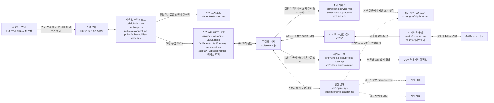

# 케셰브 현재 구현·구성 안내 (학생용)

이 문서는 현재 `on-client` 제출본의 학생 표시 기능과 실제 코드 경계를 설명합니다. 제공 기준 문서와 구별되는 프로젝트별 구현 설명입니다. 파일을 읽어 정리했으며, 이 문서 작성 중 앱·브라우저·외부 서비스는 실행하지 않았습니다. 따라서 설치된 Node.js 버전, 실제 연결, 화면 동작과 제출 판정은 확인되지 않았습니다.

## 실행 환경과 시작 방법

| 항목 | 현재 파일에서 확인한 값 | 실제 PC에서 확인 |
|---|---|---|
| 앱 버전 | `package.json`: `alekov-client-starter` `0.2.11` | 파일 기준만 확인 |
| Node.js | `package.json`의 기준 버전 `24.19.0` | 설치된 버전 미확인 |
| npm 의존성 | 외부 의존성 목록 없음 | 설치 실행은 하지 않음 |
| npm 스크립트 | `start`, `demo`, `check` (`test`는 정의되어 있지 않음) | 명령 실행은 하지 않음 |
| 앱 주소 | 기본 `http://127.0.0.1:5189/` | 브라우저 접속 미확인 |

프로젝트의 `on-client` 폴더를 파일 탐색기에서 열고 주소 표시줄에 `powershell`을 입력해 그 위치에서 PowerShell을 엽니다. 다음 명령을 실행합니다.

```powershell
powershell -NoProfile -ExecutionPolicy Bypass -File .\tools\start-alekov.ps1
```

실행 도구가 출력하도록 작성된 정상 시작 안내는 다음과 같습니다. 이 메시지를 실제로 본 것은 아닙니다.

```text
케셰브가 켜졌습니다. 브라우저에서 http://127.0.0.1:5189/ 을 여세요.
서버가 응답한 것만 확인했습니다. AI 연결 상태는 화면에서 따로 확인해 주세요.
```

브라우저에서 `http://127.0.0.1:5189/`을 엽니다. 앱을 종료할 때는 실행 중인 PowerShell에서 `Ctrl+C`를 누르고, 다시 켤 때는 같은 `on-client` 폴더에서 위 명령을 다시 실행합니다. 포트가 이미 사용 중이면 기존 프로세스를 임의로 종료하지 말고, 실행 도구 안내에 따라 포트를 바꾸고 브라우저 주소도 맞춥니다.

## 현재 제출본의 글로 쓴 구성도



### 자료 흐름과 구성 요소의 책임

1. 브라우저의 제공 코드(`public/app.js`와 보조 화면 모듈)는 로컬 서버의 HTTP API를 요청하고 응답을 받습니다. 제공 UI가 그 응답 일부를 학생 확장 함수에 전달합니다. `student/extension.mjs`는 받은 값을 화면에 표시하며, 이 파일 자체가 서버 API 요청을 보내거나 인증 정보를 보관하는 역할은 아닙니다.
2. `src/server.mjs`는 로컬 API 경계입니다. `/api/me`, `/api/apps`, `/api/access`, `/api/events`, `/api/devices`, `/api/sessions` 등은 제공 서버가 입력을 처리해 연결 엔진의 자료·판정을 반환하는 계약입니다. 기본 연결 어댑터는 `student/engine-adapter.mjs`의 `disconnected` 상태입니다. 명시적 예제 모드는 실제 SDP 연결과 다릅니다.
3. 엔진 연결이 운영 측 설정으로 제공된 경우 서버의 엔진 경계가 SDP 호스트 기능을 호출할 수 있습니다. `src/engine/sdp-host.mjs`는 서버 전용 연결 모듈입니다. 브라우저나 학생 렌더러가 SDP를 직접 호출하는 구조가 아닙니다.
4. AI 연결·모델 점검·사건 설명은 `src/ai/`의 서버 측 서비스와 `vendor/clco-http.mjs` 통신 경계를 거쳐 앱 권한이 준비된 경우 게이트로 전달됩니다. 모델 목록 점검은 사건 설명 호출과 다릅니다. 실제 계정 권한이나 AI 응답 성공은 이 문서 작성 중 확인하지 않았습니다.
5. 패키지 조회는 제공 서버의 `src/vulnerabilities/project-scan.mjs`가 잠금 파일과 설치 메타데이터를 확인하고 `src/vulnerabilities/osv.mjs`의 OSV 조회 경계를 사용합니다. 공개 조회는 운영자가 승인한 패키지 범위에 한정됩니다. 학생 함수는 조회를 실행하지 않고 결과를 표시합니다.
6. 조치의 서버 측 처리 경계는 `src/actions/service.mjs`와 엔진 연결 모듈입니다. 학생의 `renderAction`은 전달된 상태를 표시합니다. 조치 요청·인증 티켓·POST 전송을 학생 렌더러에 추가하는 것은 이 과제 범위가 아닙니다. 현재 안내된 SDP 기록의 `supportedActions`는 비어 있으므로 실제 조치 연결이 준비됐다고 쓰지 않습니다.
7. ALEPH 포털은 과제 안내와 제출·공식 판정을 담당합니다. 로컬 앱을 실행하거나 SDP·AI 요청을 중계하는 런타임 구성 요소가 아닙니다.

## 이번 프로젝트의 학생 표시 기능

아래는 `student/extension.mjs`에 있는 학생 표시 함수들의 현재 목적을 입력 계약과 단계 구현 범위에 맞춰 요약한 것입니다. 함수 이름과 실제 화면 동작은 구분합니다. 실제 브라우저 확인은 하지 않았습니다.

| 함수 | 현재 학생 표시 기능 | 제공 코드가 맡는 작업 |
|---|---|---|
| `renderIdentity` | `me`, `devices`, `sessions`의 로딩·성공·오류를 나누고 사용자·기기·세션 ID, 이름과 상태를 표시합니다. 기기·세션 상태는 한국어 뜻과 원래 코드값을 함께 나타냅니다. | 계정·기기·세션 자료 조회와 다시 불러오기 |
| `renderDecision` | `idle / loading / ok / error`를 나누어 선택 앱, 판정 코드와 한국어 뜻, 이유, 시각을 표시합니다. 요청 실패를 거부 판정과 구분합니다. | 업무 앱 목록, 접근 요청과 서버 판정 |
| `renderEvents` | 본인 기록을 최신순으로 표시하고 종류·앱·접속 상태 필터와 기록 상세를 제공합니다. 근거·규칙·접속·세션·기기 상태를 표시하며 빈 결과와 오류를 구분합니다. | 본인 범위 기록 조회, 목록 한도와 응답 데이터 전달 |
| `renderStatus` | 기기·세션의 로딩·빈 목록·오류, 알림, 전달된 진단 항목을 표시합니다. 도움정보 복사는 사용자가 버튼을 눌렀을 때만 실행되며, 지원되지 않는 조치는 비활성 안내로 표시합니다. | 기기·세션·진단 조회 및 목록 갱신 |
| `renderAiConnection` | AI 연결 점검의 `idle / loading / ok / error`, 시험/검증 상태와 모델 수·점검 시각을 표시합니다. 연결 점검과 사건 설명을 구분합니다. | 승인 흐름과 API 연결 점검 요청 |
| `renderExplanation` | 선택 이벤트의 참고용 AI 요약을 해당 이벤트의 근거 ID·근거 문장·규칙과 연결해 표시합니다. 확인 불가 상태와 제안을 구분하고, 제안은 미실행·사람 확인 필요로 나타냅니다. | 서버의 사건 설명 요청, 입력·출력·근거 검증 |
| `renderAction` | 조치 준비·전송·대기·만료·결과 조회 상태를 구분합니다. 실제 효과 확인은 성공 상태와 `observation.effectApplied === true`가 모두 확인된 경우에만 나타냅니다. | 조치 승인·처리 요청, 영수증 및 서버 관측 결과 조회 |
| `renderVulnerabilities` | 조회 상태, lockfile 메타데이터, 패키지의 정확한 설치 버전·출처·확인 시각과 취약점 ID·수정 시각을 표시합니다. 일부 조회·미조회·조회 불가와 알려진 항목 없음을 구분합니다. | 잠금 파일·설치 메타데이터 검사와 승인 범위의 OSV 요청 |

화면 표시 함수의 구현은 API의 원본 판정, 실제 네트워크 응답, 권한 부여 또는 서버 조치 집행을 대신하지 않습니다. 기본 연결 없음, 예제 모드, 미조회, 확인 불가를 연결 성공·안전·취약점 없음으로 바꾸어 해석하지 않습니다.

## 제공 코드와 학생 코드의 경계

| 범위 | 실제 경로 | 담당 |
|---|---|---|
| 학생 표시 구현 | `student/extension.mjs` | 과제에서 지정한 `render*` 함수 |
| 제공 브라우저 UI·메뉴·요청 | `public/app.js`, `public/ai-connect.mjs`, `public/vulnerabilities-view.mjs` | 화면 틀, 메뉴, API 요청·취소·갱신과 학생 함수 호출 |
| 로컬 API·업무 서비스 | `src/server.mjs`, `src/engine.mjs`, `src/engine/`, `src/ai/`, `src/actions/`, `src/vulnerabilities/` | API 입력 처리, 서버 측 연결·검증·조회·결과 반환 |
| 통신 경계 | `vendor/clco-http.mjs` 및 서버 측 연결 모듈 | 서버에서 외부 서비스 통신; 비밀을 브라우저로 보내지 않음 |
| 기존 보안 시스템 | 운영자가 준비한 SDP/호스트 연결 | 접근 판정·본인 범위 기록·정책과 실제 처리 |
| 과제 절차 | ALEPH 포털 | 단계 안내, 제출과 공식 판정 |

학생 과제에서 제공 파일인 `public/`, `src/`, `vendor/`, 판정 코드와 인증 설정은 임의 수정 대상이 아닙니다. 이 설명서는 함수의 책임을 기록할 뿐 해당 단계의 통과 판정이나 실제 연결을 주장하지 않습니다.

## 오류별 확인 순서와 미확인 범위

| 증상 | 확인 순서 |
|---|---|
| 앱이 시작되지 않음 | 앱 폴더에서 실행했는지, Node.js가 설치되어 있는지, 실행 창에 나온 오류와 포트 안내를 확인합니다. 기존 프로세스를 임의로 종료하거나 프로젝트 파일을 지우지 않습니다. |
| `disconnected` 또는 연결 확인 불가 | 기본 실행에서는 연결 없음이 예상될 수 있습니다. 운영 담당자에게 승인된 설정·계정 준비 여부를 확인합니다. 학생 코드에서 임의 연결이나 자격을 추가하지 않습니다. |
| AI 권한 준비·인증·한도·시간 초과 오류 | 화면의 안전한 오류 코드와 안내를 확인하고, 안내된 경우에만 담당자에게 권한 준비 여부를 문의합니다. API 키·토큰은 복사하거나 전송하지 않습니다. 모델 목록 점검 성공을 사건 설명 성공으로 보지 않습니다. |
| 보안 기록·기기·세션 오류 | 빈 결과와 조회 실패를 구분합니다. 제공 화면의 다시 불러오기를 직접 눌러 새 요청을 보냅니다. 오류 뒤 옛 자료를 현재 결과로 간주하지 않습니다. |
| OSV `not_configured`, `not_checked`, `partial`, `unverifiable` | 조회 미설정·미조회·일부 실패·확인 불가를 취약점 없음과 구분합니다. 패키지 버전이나 운영자 승인 목록을 임의로 바꾸지 않습니다. |
| 조치가 지원되지 않음 또는 결과 확인 불가 | 제공된 상태를 그대로 확인하고, ACK를 집행 성공으로 해석하지 않습니다. 화면에서 임의로 조치 요청을 반복하거나 정책을 변경하지 않습니다. |

**문서와 소스 대조로 확인한 것:** 앱 버전·스크립트 계약, 파일 경로, 학생 렌더러 이름, API 및 제공 모듈의 역할 경계.  
**확인하지 않은 것:** 이 PC의 설치 버전, 실제 앱 실행과 화면 동작, 현재 계정·SDP 연결, 앱 권한, AI·OSV 외부 요청 결과, 조치 집행, 포털 제출·공식 판정. 이 문서 작성 과정에서 테스트·유료 AI 요청·보안 조치·제출은 하지 않았습니다.
